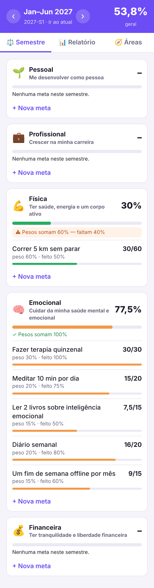
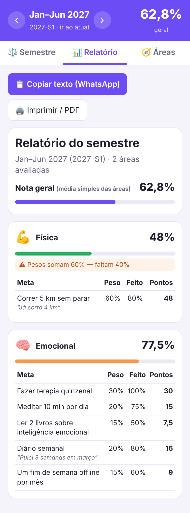

# 🧭 Gestor de Vida

Meu gestor de vida pessoal: áreas da vida, metas semestrais com pesos
("pesagem"), acompanhamento do progresso e relatório do semestre.
Feito com Google Apps Script + Google Planilhas, roda de graça na minha conta Google.

A estrutura e as regras estão em [`docs/ESTRUTURA.md`](docs/ESTRUTURA.md).

| Semestre | Relatório |
|---|---|
|  |  |

## Fase 1 — o que já faz

- Áreas da vida personalizáveis (5 padrão + criar/editar/desativar).
- Semestres fixos (jan–jun / jul–dez), navegando entre eles.
- Metas por área com **peso**; o app avisa quando os pesos não somam 100%.
- Registro de quanto foi feito (0–100%) com comentário e histórico.
- Pontos por meta (peso × % feito), nota por área e nota geral (média simples).
- Copiar as metas do semestre anterior para começar a nova pesagem.
- Relatório do semestre: copiar como texto (WhatsApp) ou imprimir/salvar PDF.

## Instalação (uma vez, ~10 minutos)

1. **Crie a planilha:** em [sheets.new](https://sheets.new), nomeie como
   `Gestor de Vida — Dados`.
2. **Abra o editor:** na planilha, menu **Extensões → Apps Script**.
3. **Cole os arquivos** deste repositório no editor:
   - Apague o conteúdo de `Código.gs` e cole o de [`Codigo.gs`](Codigo.gs).
   - Clique em **+ → Script** e crie `Banco`, `Calculo` e `Api` (o editor
     adiciona o `.gs`), colando o conteúdo de cada arquivo.
   - Clique em **+ → HTML** e crie `Index`, `Estilo` e `App`, colando o
     conteúdo de cada `.html`.
   - Em **Configurações do projeto (⚙️)**, marque *"Mostrar o arquivo de
     manifesto appsscript.json"*, volte ao editor e substitua o conteúdo
     de `appsscript.json` pelo deste repositório.
4. **Configure:** selecione a função `configurar` na barra de cima e clique
   em **Executar**. Autorize o acesso (é o seu próprio script; se aparecer
   "app não verificado", clique em *Avançado → Acessar*). As abas `Areas`,
   `Metas` e `Avaliacoes` aparecem na planilha.
5. **Publique:** **Implantar → Nova implantação → ⚙️ App da Web**.
   Executar como: *Eu*; Quem pode acessar: *Somente eu*. Copie a URL.
6. **No Android:** abra a URL no Chrome → menu **⋮ → Adicionar à tela
   inicial**. Pronto, vira um ícone como um app.

### Atualizando depois

Cole os arquivos alterados no editor e vá em **Implantar → Gerenciar
implantações → ✏️ → Versão: Nova versão → Implantar**. A URL continua a mesma.

## Arquivos

| Arquivo | Papel |
|---|---|
| `Codigo.gs` | Entrada do web app e a função `configurar` |
| `Banco.gs` | Leitura/gravação nas abas da planilha |
| `Calculo.gs` | Regras: semestres, pontos, notas |
| `Api.gs` | Funções chamadas pela tela |
| `Index.html`, `Estilo.html`, `App.html` | Interface (estrutura, visual e comportamento) |

## Próximas fases

- **Fase 2:** hábitos diários e integração com o Google Agenda.
- **Fase 3:** jogo inspirado no Habitica (XP, níveis por área, recompensas).
